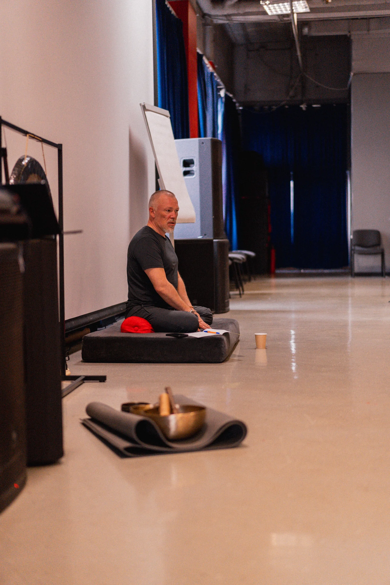

# Photo viewer source and integration

PhotoSwipe **5.4.4**, Dmitry Semenov, MIT license. The official distribution files and the full license are stored locally in `vendor/photoswipe/`. No CDN, font host, analytics, framework, or external runtime import is required.

Sources, verified on 2026-11-11:

- Release: https://github.com/dimsemenov/PhotoSwipe/releases/tag/v5.4.4
- Lightbox: https://raw.githubusercontent.com/dimsemenov/PhotoSwipe/v5.4.4/dist/photoswipe-lightbox.esm.min.js
- Core: https://raw.githubusercontent.com/dimsemenov/PhotoSwipe/v5.4.4/dist/photoswipe.esm.min.js
- CSS: https://raw.githubusercontent.com/dimsemenov/PhotoSwipe/v5.4.4/dist/photoswipe.css
- MIT license: https://raw.githubusercontent.com/dimsemenov/PhotoSwipe/v5.4.4/LICENSE
- Integration: https://photoswipe.com/getting-started/
- Options: https://photoswipe.com/options/

## Markup contract

Load the local stylesheet and module:

```html
<link rel="stylesheet" href="vendor/photoswipe/photoswipe.css">
<script type="module" src="photo-viewer.js"></script>
```

Each `[data-photo-gallery]` container is an independent photo set. Wrap the actual thumbnail image in an ordinary link to its original image:

```html
<div class="community-gallery" data-photo-gallery>
  <figure>
    <a href="RV-21-05-1.webp"
       data-pswp-width="1024" data-pswp-height="768"
       data-cropped="true" aria-label="Открыть фотографию занятия">
      
    </a>
  </figure>
</div>
```

Use the real original file dimensions; do not derive them from CSS frame sizes. `data-cropped="true"` is for thumbnails whose CSS frame crops the source. Keep useful `alt` text. The anchor must remain a valid direct image link: without JavaScript, or if the optional lightbox module cannot load, the image remains accessible through the browser. Do not add click interception to these anchors in another script.

The core is imported only when a photo is opened. Controls and the image error message are Russian. Focus trapping, focus return, Escape, and keyboard arrows are enabled. The system reduced-motion preference disables open/close/zoom transitions and is observed for later changes.

The existing hero photo stack and contact dialog are independent; this module does not modify either one. Retain `vendor/photoswipe/LICENSE` when publishing these files.

## Validation

Node syntax checks are required for the integration module and both distribution modules. Rendered interaction verification belongs to the main task: open a photo, change slides, zoom, close with Escape, verify focus returns, and check a narrow mobile viewport. No browser or deployment changes were made by the contributor of these files.
